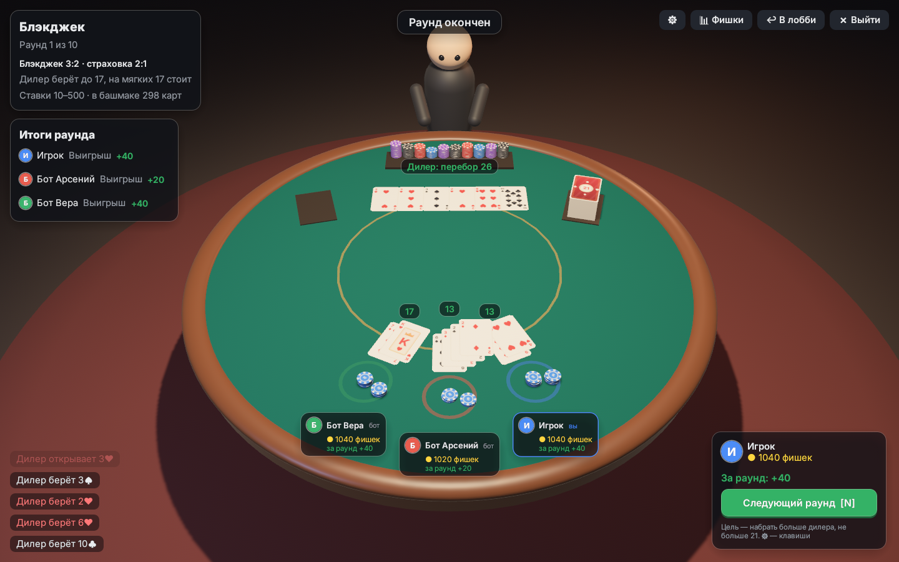

# Game Box

Игровой лаунчер на Rust (Bevy + egui) с тремя настольными играми:

- **Монополия**: порт 2D-версии из [frd21313123123/monopoly](https://github.com/frd21313123123/monopoly) (московское издание). Логика переписана с TypeScript на Rust один в один: аренда, дома и отели, залог, тюрьма, карточки «Шанс» и «Казна», аукционы, торговля, предложение покупки другому игроку, долги вместо мгновенного банкротства. 3D-режим оригинала не переносился.
- **Уно**: карточная игра по классическим правилам «четырёх цветов» на 3D-столе. Игроки сидят вокруг стола, над головами у них ники. Сыгранные карты летят в сброс, на столе остаются только последние 9, более старые уезжают из-под стопки и тают.
- **Блэкджек** («21»): игра против дилера на том же 3D-столе. Дилер стоит за столом, боксы игроков идут дугой по ближнему краю. Карты вылетают из башмака, закрытая карта дилера переворачивается, ставки въезжают фишками, проигранные уходят в лоток дилера, а выигрыш выезжает из него.




## Возможности

- Главное меню, профиль, лобби с ботами и выбором фишки/цвета (для Монополии).
- Игра с ботами, по локальной сети/интернету по IP (TCP, порт `27015`) или через **Steam** (лобби, приглашение друзей через оверлей, P2P без проброса портов).
- Ники из Steam, если игра собрана с фичей `steam` и Steam запущен. Иначе берётся локальный ник, который можно поменять в меню.
- Хост считает правила, клиенты только отправляют свои действия. В карточной игре каждый получает урезанное состояние, поэтому чужие карты по сети не передаются.
- Если игрок отключился посреди партии, его место занимает бот.
- Звуки синтезируются при запуске, графика карт рисуется процедурно, поэтому внешних ассетов, кроме шрифта Inter (OFL), нет.

### Правила «Уно»

108 карт: цифры 0–9, «Пропуск», «Смена направления», «+2», «Заказ цвета», «+4».
- Класть можно карту того же цвета или значения, а «Заказ цвета» и «+4» в любой момент.
- Если ходить нечем, берёте карту. Взятую карту можно сразу сыграть, если она подходит.
- «Смена направления» при двух игроках работает как «Пропуск».
- «+4» можно положить, только если нет карты текущего цвета. Следующий игрок может **оспорить**: если был блеф, нарушитель берёт 4, иначе оспоривший берёт 6.
- Когда остаётся одна карта, нужно нажать **«Последняя!»**. Кто забыл, того можно поймать до хода следующего игрока, и он берёт 2 карты.
- Очки: цифры по номиналу, действия по 20, чёрные карты по 50. Матч идёт до 500/200 очков или одну партию.

Управление мышью: клик по карте в руке играет её, клик по колоде берёт карту, остальное делается кнопками справа внизу.

Управление с клавиатуры (по умолчанию):

| Действие | Клавиша |
|---|---|
| Выбрать карту в руке | ← / → |
| Сыграть выбранную карту (первый Enter выбирает, второй играет) | Enter |
| Взять карту | D |
| Оставить и пропустить (после добора) | S |
| «Последняя!» | Пробел |
| Поймать без «Последней!» | C |
| Заказать цвет (окно выбора) | 1 / 2 / 3 / 4 |
| Оспорить / взять 4 карты (окно «+4») | X / A |
| Таблица счёта | Tab |
| Следующий раунд / в лобби (после раунда) | N |
| Закрыть окно / выйти из игры | Esc |

Все клавиши меняются в настройках (кнопка ⚙ в правом верхнем углу стола). Клавиши привязываются по физическому положению, поэтому на русской раскладке подпись на кнопке будет латинской буквой на той же клавише. Настройки хранятся в профиле.

### Правила Блэкджека

Башмак из 6 колод, перемешивается, когда сыграно 75% карт. От 1 до 7 игроков против дилера.
- Каждый раунд все игроки делают ставку от 10 до 500 (кратно 10), затем всем раздают по две открытые карты, дилеру одну открытую и одну закрытую.
- Картинки стоят 10, туз 1 или 11. Блэкджек (21 с первых двух карт) платит 3:2, обычный выигрыш 1:1, при равенстве ставка возвращается.
- Ходы: **ещё карту**, **хватит**, **удвоить** (на первых двух картах, в том числе после сплита: ставка удваивается, приходит ровно одна карта), **разделить** пару одинаковых карт (до 4 рук; разделённые тузы получают по одной карте, 21 после сплита не считается блэкджеком).
- Если у дилера открыт туз, игроки могут взять **страховку** за половину ставки, она платит 2:1. С тузом или десяткой дилер сразу проверяет блэкджек.
- Дилер добирает до 17 и стоит на любых 17, в том числе мягких.
- Матч длится 5, 10 или 20 раундов либо пока у кого-то есть фишки (задаётся в лобби вместе со стартовыми фишками). Кому не хватает на минимальную ставку, тот выбывает и наблюдает. Побеждает тот, у кого больше всего фишек.

Управление с клавиатуры (по умолчанию):

| Действие | Клавиша |
|---|---|
| Ставка +10 / −10 | ↑ / ↓ |
| Сделать ставку | Enter |
| Повторить прошлую ставку | R |
| Ещё карту / хватит | H / S |
| Удвоить / разделить пару | D / P |
| Взять страховку / без страховки | I / O |
| Таблица фишек | Tab |
| Следующий раунд / в лобби | N |
| Закрыть окно / выйти из игры | Esc |

Клавиши тоже меняются кнопкой ⚙ на столе и хранятся в профиле отдельно от клавиш Уно.

## Сборка и запуск

```bash
cargo run --release
```

Linux: нужны `libasound2-dev libudev-dev libxkbcommon-dev libwayland-dev` (как для любого Bevy-проекта).

### Steam

```bash
cargo run --release --features steam
```

- Steam должен быть запущен. По умолчанию используется тестовый AppID 480 (Spacewar). Свой AppID задаётся в `steam_appid.txt` рядом с exe.
- Рядом с исполняемым файлом должна лежать библиотека Steam API (`steam_api64.dll` / `libsteam_api.so` / `libsteam_api.dylib`). Её можно взять из `target/<profile>/build/steamworks-sys-*/out/`.
- Хост в лобби нажимает «Пригласить друзей Steam». Друзья принимают приглашение в оверлее или выбирают «Присоединиться к игре» в списке друзей.

### Автообновление

При запуске лаунчер проверяет последний релиз на GitHub. Если он новее текущей версии (`version` в `Cargo.toml`), в левом нижнем углу меню появляется кнопка «Обновить и перезапустить». В Windows она скачивает `game-box-windows-x64.zip`, закрывает игру, заменяет файлы в папке программы и запускает новую версию. Профиль и сохранения лежат в домашней папке пользователя и не затрагиваются. На других системах кнопка открывает страницу релиза.

Чтобы выключить проверку, задайте `GAMEBOX_NO_UPDATE=1`. Версия выпускается тегом `vX.Y.Z` (workflow «Release»), он должен совпадать с `version` в `Cargo.toml`.

Каждая сборка основной ветки (`claude/rust-game-launcher-px1e6e`, список веток задан в `on.push` файла `ci.yml`; workflow «CI») публикуется на странице Releases как предрелиз `build-N` с готовым zip для Windows. Лаунчер такие сборки не предлагает: он берёт только последний обычный релиз (`vX.Y.Z`), а предрелизы GitHub в нём пропускает. Поэтому предрелиз не должен становиться обычным релизом, иначе автообновление перестанет работать.

## Тесты

```bash
cargo test --workspace
```

Ядра игр проверяются полными партиями ботов: карты не теряются, деньги не уходят в минус, у участка не бывает двух владельцев. В Блэкджеке отдельно проверены выплаты 3:2, страховка, удвоение, сплит и ход дилера. Отдельно проверены правила, сетевой транспорт и генерация текстур.

## Структура

| Путь | Что внутри |
|---|---|
| `crates/uno-core` | правила карточной игры, события для анимаций, боты (без зависимостей от движка) |
| `crates/blackjack-core` | правила Блэкджека: башмак, ставки, страховка, удвоение, сплит, ход дилера, боты по базовой стратегии |
| `crates/monopoly-core` | порт редьюсера Монополии, авторизация действий, бот |
| `crates/netcode` | транспорт: трейт `Transport`, TCP-хост/клиент с кадрированием |
| `launcher/src/net.rs` | сессия, лобби, протокол (JSON), маршрутизация действий |
| `launcher/src/steam.rs` | интеграция со Steam (фича `steam`) |
| `launcher/src/uno/` | 3D-стол Уно, текстуры карт, HUD |
| `launcher/src/blackjack/` | 3D-стол Блэкджека, игральные карты и фишки, HUD |
| `launcher/src/table3d.rs`, `binds.rs` | общее для карточных столов: комната, фигуры, полёт карт; настройка клавиш |
| `launcher/src/monopoly/` | 2D-поле, боковая панель, диалоги |
| `launcher/src/menu.rs`, `lobby.rs` | меню и лобби |

### Переменные окружения для разработки

- `GAMEBOX_AUTOSTART=uno|monopoly|blackjack|lobby-uno|lobby-monopoly|lobby-blackjack`: сразу запустить игру или лобби.
- `GAMEBOX_BOTS=N`: число ботов при автозапуске.
- `GAMEBOX_AUTOPLAY=1`: за вас тоже играет бот.
- `GAMEBOX_OPEN_TCP=1`, `GAMEBOX_START_AFTER=сек`, `GAMEBOX_JOIN=ip:порт`: проверка сетевой игры.
- `GAMEBOX_SCREENSHOT=file.png`, `GAMEBOX_SCREENSHOT_AFTER=сек`: сделать скриншот и выйти.
- `GAMEBOX_NO_UPDATE=1`: не проверять обновления при запуске.
